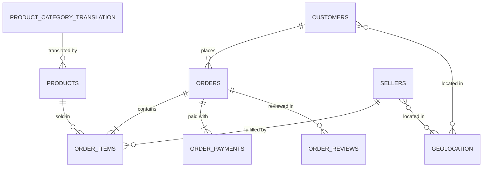

# OlistIQ — SQL Analytics Intelligence Platform
### End-to-End Data Engineering & Business Intelligence on 100K Brazilian E-Commerce Orders

[](https://madhav70.github.io/olist-ecommerce-sql-analytics/)
[](https://github.com/Madhav70/olist-ecommerce-sql-analytics)

[](https://sqlite.org)
[](https://python.org)
[](scripts/load_database.py)
[-yellow)](https://www.kaggle.com/datasets/olistbr/brazilian-ecommerce)
[](LICENSE)

> **A production-grade SQL data engineering and analytics project** transforming 9 raw CSV files (~100K orders, 2016–2018) into a fully normalized relational database, automated ETL pipeline, 8 analytical SQL queries, 5 reporting views, and an HR-ready interactive live dashboard — powered by pure SQL and Python.

---

##  Live Dashboard

An interactive, single-page analytics dashboard showcasing all project findings — designed for recruiters and hiring managers who want to explore the data without running any code.

** [https://madhav70.github.io/olist-ecommerce-sql-analytics/](https://madhav70.github.io/olist-ecommerce-sql-analytics/)**

| Tab | Content |
| :--- | :--- |
| **Executive Overview** | Platform KPIs, GMV trend chart, Black Friday spike, day-of-week patterns |
| **Customer Intelligence** | RFM segmentation donut chart, repeat purchase rate, repurchase timing |
| **Logistics & Delivery SLA** | On-time vs delayed impact on ratings, state-by-state late rates |
| **Product & Category Analytics** | Top category revenue, freight friction table, cross-selling basket pairs |
| **Payment Analytics** | Payment method mix, installment ticket elasticity |

---

** [View the Live Interactive Dashboard →](https://madhav70.github.io/olist-ecommerce-sql-analytics/)**

---

##  Live Dashboard

An interactive, single-page analytics dashboard showcasing all project findings — designed for recruiters and hiring managers who want to explore the data without running any code.

** [https://madhav70.github.io/olist-ecommerce-sql-analytics/](https://madhav70.github.io/olist-ecommerce-sql-analytics/)**

| Tab | Content |
| :--- | :--- |
| **Executive Overview** | Platform KPIs, GMV trend chart, Black Friday spike, day-of-week patterns |
| **Customer Intelligence** | RFM segmentation donut chart, repeat purchase rate, repurchase timing |
| **Logistics & Delivery SLA** | On-time vs delayed impact on ratings, state-by-state late rates |
| **Product & Category Analytics** | Top category revenue, freight friction table, cross-selling basket pairs |
| **Payment Analytics** | Payment method mix, installment ticket elasticity |

---

---

##  Live Dashboard

An interactive, single-page analytics dashboard showcasing all project findings — designed for recruiters and hiring managers who want to explore the data without running any code.

** [https://madhav70.github.io/olist-ecommerce-sql-analytics/](https://madhav70.github.io/olist-ecommerce-sql-analytics/)**

| Tab | Content |
| :--- | :--- |
| **Executive Overview** | Platform KPIs, GMV trend chart, Black Friday spike, day-of-week patterns |
| **Customer Intelligence** | RFM segmentation donut chart, repeat purchase rate, repurchase timing |
| **Logistics & Delivery SLA** | On-time vs delayed impact on ratings, state-by-state late rates |
| **Product & Category Analytics** | Top category revenue, freight friction table, cross-selling basket pairs |
| **Payment Analytics** | Payment method mix, installment ticket elasticity |

---

## Table of Contents
1. [Project Overview & Key Results](#project-overview--key-results)
2. [ Live Dashboard](#-live-dashboard)
3. [Repository Structure](#repository-structure)
4. [Relational Schema & Architecture](#relational-schema--architecture)
5. [Quickstart Guide](#quickstart-guide)
6. [Advanced SQL Techniques Demonstrated](#advanced-sql-techniques-demonstrated)
7. [SQL Query Portfolio & Findings](#sql-query-portfolio--findings)
8. [Reporting Views](#reporting-views)
9. [Documentation Links](#documentation-links)

---

##  Live Dashboard

An interactive, single-page analytics dashboard showcasing all project findings — designed for recruiters and hiring managers who want to explore the data without running any code.

** [https://madhav70.github.io/olist-ecommerce-sql-analytics/](https://madhav70.github.io/olist-ecommerce-sql-analytics/)**

| Tab | Content |
| :--- | :--- |
| **Executive Overview** | Platform KPIs, GMV trend chart, Black Friday spike, day-of-week patterns |
| **Customer Intelligence** | RFM segmentation donut chart, repeat purchase rate, repurchase timing |
| **Logistics & Delivery SLA** | On-time vs delayed impact on ratings, state-by-state late rates |
| **Product & Category Analytics** | Top category revenue, freight friction table, cross-selling basket pairs |
| **Payment Analytics** | Payment method mix, installment ticket elasticity |

---

## Project Overview & Key Results

| Executive KPI | Value | Business Context |
| :---

##  Live Dashboard

An interactive, single-page analytics dashboard showcasing all project findings — designed for recruiters and hiring managers who want to explore the data without running any code.

** [https://madhav70.github.io/olist-ecommerce-sql-analytics/](https://madhav70.github.io/olist-ecommerce-sql-analytics/)**

| Tab | Content |
| :--- | :--- |
| **Executive Overview** | Platform KPIs, GMV trend chart, Black Friday spike, day-of-week patterns |
| **Customer Intelligence** | RFM segmentation donut chart, repeat purchase rate, repurchase timing |
| **Logistics & Delivery SLA** | On-time vs delayed impact on ratings, state-by-state late rates |
| **Product & Category Analytics** | Top category revenue, freight friction table, cross-selling basket pairs |
| **Payment Analytics** | Payment method mix, installment ticket elasticity |

--- | :---

##  Live Dashboard

An interactive, single-page analytics dashboard showcasing all project findings — designed for recruiters and hiring managers who want to explore the data without running any code.

** [https://madhav70.github.io/olist-ecommerce-sql-analytics/](https://madhav70.github.io/olist-ecommerce-sql-analytics/)**

| Tab | Content |
| :--- | :--- |
| **Executive Overview** | Platform KPIs, GMV trend chart, Black Friday spike, day-of-week patterns |
| **Customer Intelligence** | RFM segmentation donut chart, repeat purchase rate, repurchase timing |
| **Logistics & Delivery SLA** | On-time vs delayed impact on ratings, state-by-state late rates |
| **Product & Category Analytics** | Top category revenue, freight friction table, cross-selling basket pairs |
| **Payment Analytics** | Payment method mix, installment ticket elasticity |

--- | :---

##  Live Dashboard

An interactive, single-page analytics dashboard showcasing all project findings — designed for recruiters and hiring managers who want to explore the data without running any code.

** [https://madhav70.github.io/olist-ecommerce-sql-analytics/](https://madhav70.github.io/olist-ecommerce-sql-analytics/)**

| Tab | Content |
| :--- | :--- |
| **Executive Overview** | Platform KPIs, GMV trend chart, Black Friday spike, day-of-week patterns |
| **Customer Intelligence** | RFM segmentation donut chart, repeat purchase rate, repurchase timing |
| **Logistics & Delivery SLA** | On-time vs delayed impact on ratings, state-by-state late rates |
| **Product & Category Analytics** | Top category revenue, freight friction table, cross-selling basket pairs |
| **Payment Analytics** | Payment method mix, installment ticket elasticity |

--- |
| **Total Orders Analyzed** | **99,441** | 96,478 delivered, 625 canceled, 2,338 in-flight. |
| **Gross Merchandise Value (GMV)** | **R$ 13,221,498.11** | Total delivered merchandise revenue. |
| **Freight Revenue** | **R$ 2,198,275.64** | Freight represents 14.26% of platform gross spend. |
| **Total Customer Spend** | **R$ 15,419,773.75** | Total gross payments captured. |
| **Average Order Value (AOV)** | **R$ 137.04** | Mean basket merchandise spend per order. |
| **Unique Real Customers** | **96,096** | 93,358 delivered order customers. |
| **Customer Repeat Purchase Rate** | **3.00%** | 2,801 repeat customers spend 1.88x more than 1-time buyers. |
| **On-Time Delivery SLA Rate** | **91.89%** | Average delivery takes 12.6 days (11.2 days before target SLA). |
| **Delivery Delay Penalty** | **4.29 -> 2.57 Stars** | Rating collapses when late; 1-star reviews surge from 6.6% to 46.2%. |
| **Financing Dependency** | **78.34% GMV via Credit Card** | 7x-10x installment orders carry 3.5x higher ticket sizes. |

---

##  Live Dashboard

An interactive, single-page analytics dashboard showcasing all project findings — designed for recruiters and hiring managers who want to explore the data without running any code.

** [https://madhav70.github.io/olist-ecommerce-sql-analytics/](https://madhav70.github.io/olist-ecommerce-sql-analytics/)**

| Tab | Content |
| :--- | :--- |
| **Executive Overview** | Platform KPIs, GMV trend chart, Black Friday spike, day-of-week patterns |
| **Customer Intelligence** | RFM segmentation donut chart, repeat purchase rate, repurchase timing |
| **Logistics & Delivery SLA** | On-time vs delayed impact on ratings, state-by-state late rates |
| **Product & Category Analytics** | Top category revenue, freight friction table, cross-selling basket pairs |
| **Payment Analytics** | Payment method mix, installment ticket elasticity |

---

## Repository Structure

```
SQL Project/
│
├── README.md                                    # Master project documentation & portfolio guide
├── olist_ecommerce.db                           # Pre-built, indexed SQLite relational database
│
├── schema/
│   ├── 01_schema_sqlite.sql                     # SQLite DDL (Primary keys, foreign keys, checks)
│   ├── 01_schema_postgres.sql                   # PostgreSQL / ANSI SQL DDL (Typed, constraints)
│   ├── 02_indexes.sql                           # Performance indexes on joins & timestamps
│   └── 03_views.sql                             # 5 denormalized reporting views (Master Order, RFM, etc.)
│
├── scripts/
│   ├── load_database.py                         # Automated ETL pipeline (cleans, deduplicates, loads)
│   └── run_query.py                             # Interactive CLI query runner with Markdown/CSV export
│
├── queries/
│   ├── 01_executive_kpis.sql                    # Platform overview & executive scorecard
│   ├── 02_customer_rfm_segmentation.sql         # RFM quantiles (NTILE), loyalty tiers & retention
│   ├── 03_sales_growth_seasonality.sql          # MoM growth (LAG), day/hour purchasing heatmap
│   ├── 04_product_category_performance.sql      # Top 15 categories, freight friction & cross-selling
│   ├── 05_logistics_delivery_sla.sql            # Delivery SLA compliance, late rates by Brazilian state
│   ├── 06_customer_reviews_sentiment.sql        # Review distributions, root causes of low ratings
│   ├── 07_payment_analytics.sql                 # Payment method mix, credit installment elasticity
│   └── 08_advanced_window_functions.sql         # Running totals, 3M moving avg, partitioned dense ranks
│
├── docs/
│   ├── data_dictionary.md                       # Comprehensive data dictionary for all 9 tables
│   ├── schema_diagram.md                        # Entity-Relationship Diagram (ERD) with Mermaid
│   └── business_insights_report.md              # Executive strategy briefing & operational roadmap
│
└── [Original 9 CSV Datasets]                    # olist_customers, orders, order_items, payments, etc.
```

---

##  Live Dashboard

An interactive, single-page analytics dashboard showcasing all project findings — designed for recruiters and hiring managers who want to explore the data without running any code.

** [https://madhav70.github.io/olist-ecommerce-sql-analytics/](https://madhav70.github.io/olist-ecommerce-sql-analytics/)**

| Tab | Content |
| :--- | :--- |
| **Executive Overview** | Platform KPIs, GMV trend chart, Black Friday spike, day-of-week patterns |
| **Customer Intelligence** | RFM segmentation donut chart, repeat purchase rate, repurchase timing |
| **Logistics & Delivery SLA** | On-time vs delayed impact on ratings, state-by-state late rates |
| **Product & Category Analytics** | Top category revenue, freight friction table, cross-selling basket pairs |
| **Payment Analytics** | Payment method mix, installment ticket elasticity |

---

## Relational Schema & Architecture

The database is normalized to Third Normal Form (3NF) to guarantee transactional integrity:



For complete field descriptions and data types, refer to the [Data Dictionary](file:///c:/Users/Admin/Downloads/SQL%20Project/docs/data_dictionary.md) and [Schema Diagram](file:///c:/Users/Admin/Downloads/SQL%20Project/docs/schema_diagram.md).

---

##  Live Dashboard

An interactive, single-page analytics dashboard showcasing all project findings — designed for recruiters and hiring managers who want to explore the data without running any code.

** [https://madhav70.github.io/olist-ecommerce-sql-analytics/](https://madhav70.github.io/olist-ecommerce-sql-analytics/)**

| Tab | Content |
| :--- | :--- |
| **Executive Overview** | Platform KPIs, GMV trend chart, Black Friday spike, day-of-week patterns |
| **Customer Intelligence** | RFM segmentation donut chart, repeat purchase rate, repurchase timing |
| **Logistics & Delivery SLA** | On-time vs delayed impact on ratings, state-by-state late rates |
| **Product & Category Analytics** | Top category revenue, freight friction table, cross-selling basket pairs |
| **Payment Analytics** | Payment method mix, installment ticket elasticity |

---

## Quickstart Guide

### Prerequisites
- Python 3.8+ installed (uses built-in `sqlite3` and `pandas`).
- No external database server installation required.

### 1. Build or Rebuild the Database (ETL Pipeline)
Run the automated ETL script to recreate tables, ingest CSVs, deduplicate coordinates, build indexes, and compile views:
```bash
python scripts/load_database.py
```
*Execution takes ~8 seconds and outputs row-count audits and foreign key verification.*

### 2. Run Any Analytical SQL Script
Use `scripts/run_query.py` to execute queries with formatted tabular outputs:
```bash
# Execute Executive KPIs
python scripts/run_query.py queries/01_executive_kpis.sql

# Execute RFM Customer Segmentation
python scripts/run_query.py queries/02_customer_rfm_segmentation.sql

# Execute Logistics & Delivery SLA Analysis
python scripts/run_query.py queries/05_logistics_delivery_sla.sql
```

### 3. Run Custom Inline Queries
You can run any custom SQL string directly from the terminal:
```bash
python scripts/run_query.py "SELECT customer_state, COUNT(*) FROM customers GROUP BY customer_state ORDER BY 2 DESC LIMIT 5;"
```

### 4. Export Query Output to CSV or Markdown
```bash
python scripts/run_query.py queries/04_product_category_performance.sql --csv output_categories.csv
```

---

##  Live Dashboard

An interactive, single-page analytics dashboard showcasing all project findings — designed for recruiters and hiring managers who want to explore the data without running any code.

** [https://madhav70.github.io/olist-ecommerce-sql-analytics/](https://madhav70.github.io/olist-ecommerce-sql-analytics/)**

| Tab | Content |
| :--- | :--- |
| **Executive Overview** | Platform KPIs, GMV trend chart, Black Friday spike, day-of-week patterns |
| **Customer Intelligence** | RFM segmentation donut chart, repeat purchase rate, repurchase timing |
| **Logistics & Delivery SLA** | On-time vs delayed impact on ratings, state-by-state late rates |
| **Product & Category Analytics** | Top category revenue, freight friction table, cross-selling basket pairs |
| **Payment Analytics** | Payment method mix, installment ticket elasticity |

---

## Advanced SQL Techniques Demonstrated

This project showcases real-world SQL engineering and analytics patterns:

1. **Common Table Expressions (CTEs & Multi-Level CTEs)**:
   - Used extensively to modularize aggregations before joining (e.g. `WITH monthly_metrics AS (...), mom_growth AS (...)`).
2. **Window Functions**:
   - `LAG()`: Computes Month-over-Month (MoM) revenue growth rates and inter-order latency between repeat purchases.
   - `ROW_NUMBER() OVER (PARTITION BY ...)`: Chronologically sequences customer purchases to identify 1st vs 2nd orders.
   - `DENSE_RANK() OVER (PARTITION BY category ORDER BY sales DESC)`: Ranks top sellers within each individual product category without skipping ranks.
   - `NTILE(5)`: Segments customers into recency, frequency, and monetary quintiles.
   - `SUM() OVER (ORDER BY ... ROWS BETWEEN UNBOUNDED PRECEDING AND CURRENT ROW)`: Calculates running cumulative GMV.
   - `AVG() OVER (ORDER BY ... ROWS BETWEEN 2 PRECEDING AND CURRENT ROW)`: Calculates 3-month rolling moving averages.
3. **Advanced Joins & Self-Joins**:
   - Self-joins on `order_items` (`oi1.order_item_id < oi2.order_item_id`) to perform Market Basket Analysis and detect co-purchasing bundles.
4. **Date & Time Functions**:
   - `STRFTIME()`, `JULIANDAY()`, and date-difference calculations to measure delivery days, carrier transit times, and customer recency.
5. **Conditional Aggregation**:
   - Pivoting and metric calculations using `CASE WHEN ... THEN ... ELSE 0 END` within `SUM()` and `COUNT()`.
6. **Query Optimization & Indexing**:
   - Strategic composite and single-column indexes on high-cardinality keys, foreign keys, and date timestamps.

---

##  Live Dashboard

An interactive, single-page analytics dashboard showcasing all project findings — designed for recruiters and hiring managers who want to explore the data without running any code.

** [https://madhav70.github.io/olist-ecommerce-sql-analytics/](https://madhav70.github.io/olist-ecommerce-sql-analytics/)**

| Tab | Content |
| :--- | :--- |
| **Executive Overview** | Platform KPIs, GMV trend chart, Black Friday spike, day-of-week patterns |
| **Customer Intelligence** | RFM segmentation donut chart, repeat purchase rate, repurchase timing |
| **Logistics & Delivery SLA** | On-time vs delayed impact on ratings, state-by-state late rates |
| **Product & Category Analytics** | Top category revenue, freight friction table, cross-selling basket pairs |
| **Payment Analytics** | Payment method mix, installment ticket elasticity |

---

## SQL Query Portfolio & Findings

### [Query 01: Executive KPIs & Overview](file:///c:/Users/Admin/Downloads/SQL%20Project/queries/01_executive_kpis.sql)
- **Objective:** Macro platform health scorecard.
- **Key Metric:** Total GMV is **R$ 13.22M** across 96,478 delivered orders. Freight adds **R$ 2.20M** (14.26% of gross customer spend).
- **Average Basket:** R$ 137.04 AOV with 1.17 items per order.

### [Query 02: Customer RFM Segmentation & Repeat Purchase](file:///c:/Users/Admin/Downloads/SQL%20Project/queries/02_customer_rfm_segmentation.sql)
- **Objective:** Quantify customer loyalty and segment buyers using Recency, Frequency, and Monetary scoring (`NTILE(5)`).
- **Key Insight:** **Repeat Purchase Rate is 3.00%** (2,801 repeat customers out of 93,358). Repeat buyers spend **R$ 260.05 on average (1.88x more)** than single-order buyers (R$ 137.96).

### [Query 03: Sales Growth, Seasonality & Peak Purchasing Patterns](file:///c:/Users/Admin/Downloads/SQL%20Project/queries/03_sales_growth_seasonality.sql)
- **Objective:** Track Month-over-Month growth (`LAG()`), Day-of-Week, and Hour-of-Day order trends.
- **Key Insight:** Peak purchasing occurs on **Mondays (16.27%) and Tuesdays (16.07%)**, dropping to 10.94% on Saturdays. Mid-day (10:00 to 16:00) represents 39% of daily volume. Black Friday (Nov 2017) spiked monthly GMV to R$ 987.7k (+52.37% MoM).

### [Query 04: Product & Category Analytics, Freight Burden & Cross-Selling](file:///c:/Users/Admin/Downloads/SQL%20Project/queries/04_product_category_performance.sql)
- **Objective:** Rank top categories, pinpoint high-friction freight ratios, and detect market basket co-occurrences.
- **Key Insight:** Top 3 categories (`health_beauty`, `watches_gifts`, `bed_bath_table`) account for 26.0% of total revenue. Heavy categories like `office_furniture` suffer from high freight friction (25.01% of item price; 11.3 kg avg weight), depressing customer review ratings to 3.52 stars.

### [Query 05: Logistics, Fulfillment Speeds & Delivery SLA Performance](file:///c:/Users/Admin/Downloads/SQL%20Project/queries/05_logistics_delivery_sla.sql)
- **Objective:** Audit on-time delivery SLA compliance and breakdown transit times across 27 Brazilian states.
- **Key Insight:** Overall on-time SLA rate is **91.89%**. Delivery takes an average of 12.6 days (3.2 days seller dispatch + 9.3 days carrier transit). Orders in São Paulo (`SP`) arrive in 8.8 days (5.88% late rate), while Northeastern states face severe logistics lag: Alagoas (`AL`) averages 24.5 days with a **23.94% late delivery rate**.

### [Query 06: Customer Reviews, Satisfaction Drivers & Delay Correlation](file:///c:/Users/Admin/Downloads/SQL%20Project/queries/06_customer_reviews_sentiment.sql)
- **Objective:** Quantify the mathematical link between logistics delays and customer ratings.
- **Key Insight:** On-time orders average **4.29 stars** (6.6% 1-star reviews). Delayed orders average **2.57 stars** (46.16% 1-star reviews). For deliveries exceeding 30 days, 1-star reviews rise to **55.89%**. Dissatisfied customers are more than twice as likely to write long text complaints (76.55% vs 35.85%).

### [Query 07: Payment Methods, Financing Patterns & Installment Economics](file:///c:/Users/Admin/Downloads/SQL%20Project/queries/07_payment_analytics.sql)
- **Objective:** Analyze Brazilian payment preferences and installment financing behavior.
- **Key Insight:** Credit cards capture **78.34% of GMV**, followed by Boleto Bancário at 17.92%. Installments drive high ticket sizes: 1x orders average R$ 95.87, whereas 7x-10x installment plans average **R$ 333.83** (3.5x higher).

### [Query 08: Advanced Window Functions & Cohorts](file:///c:/Users/Admin/Downloads/SQL%20Project/queries/08_advanced_window_functions.sql)
- **Objective:** Advanced analytical SQL modeling.
- **Key Insight:** Computes running cumulative GMV reaching R$ 13.18M by Aug 2018; partitions seller leadership within top product categories; and calculates that **36.31% of repeat buyers make their second purchase within 7 days**.

---

##  Live Dashboard

An interactive, single-page analytics dashboard showcasing all project findings — designed for recruiters and hiring managers who want to explore the data without running any code.

** [https://madhav70.github.io/olist-ecommerce-sql-analytics/](https://madhav70.github.io/olist-ecommerce-sql-analytics/)**

| Tab | Content |
| :--- | :--- |
| **Executive Overview** | Platform KPIs, GMV trend chart, Black Friday spike, day-of-week patterns |
| **Customer Intelligence** | RFM segmentation donut chart, repeat purchase rate, repurchase timing |
| **Logistics & Delivery SLA** | On-time vs delayed impact on ratings, state-by-state late rates |
| **Product & Category Analytics** | Top category revenue, freight friction table, cross-selling basket pairs |
| **Payment Analytics** | Payment method mix, installment ticket elasticity |

---

## Reporting Views

The database includes 5 pre-compiled views ready for BI dashboards (Power BI, Tableau, Metabase) or direct SQL queries:

1. `vw_order_master`: Denormalized single-row-per-order view with customer geography, spend, freight, payment types, delivery latency, and SLA delay flags.
2. `vw_customer_rfm_raw`: Customer-level aggregation of orders, lifetime spend, first/last purchase dates, and days since last purchase.
3. `vw_product_category_summary`: Category-level aggregation of orders, units, GMV, freight, ASP, and customer rating.
4. `vw_seller_scorecard`: Merchant-level sales volume, revenue, average delivery duration, late delivery rate, and average review score.
5. `vw_zip_code_geolocation`: Spatial lookup computing centroid coordinates `(AVG(lat), AVG(lng))` per postal code prefix.

---

##  Live Dashboard

An interactive, single-page analytics dashboard showcasing all project findings — designed for recruiters and hiring managers who want to explore the data without running any code.

** [https://madhav70.github.io/olist-ecommerce-sql-analytics/](https://madhav70.github.io/olist-ecommerce-sql-analytics/)**

| Tab | Content |
| :--- | :--- |
| **Executive Overview** | Platform KPIs, GMV trend chart, Black Friday spike, day-of-week patterns |
| **Customer Intelligence** | RFM segmentation donut chart, repeat purchase rate, repurchase timing |
| **Logistics & Delivery SLA** | On-time vs delayed impact on ratings, state-by-state late rates |
| **Product & Category Analytics** | Top category revenue, freight friction table, cross-selling basket pairs |
| **Payment Analytics** | Payment method mix, installment ticket elasticity |

---

## Documentation Links

- [Data Dictionary](file:///c:/Users/Admin/Downloads/SQL%20Project/docs/data_dictionary.md): Detailed column-by-column metadata and schema descriptions.
- [Entity-Relationship Diagram](file:///c:/Users/Admin/Downloads/SQL%20Project/docs/schema_diagram.md): Complete visual ERD and normalization documentation.
- [Executive Business Insights Report](file:///c:/Users/Admin/Downloads/SQL%20Project/docs/business_insights_report.md): Deep-dive strategic report with operational recommendations.
- [SQLite Schema DDL](file:///c:/Users/Admin/Downloads/SQL%20Project/schema/01_schema_sqlite.sql) & [PostgreSQL Schema DDL](file:///c:/Users/Admin/Downloads/SQL%20Project/schema/01_schema_postgres.sql)
- [Indexes Script](file:///c:/Users/Admin/Downloads/SQL%20Project/schema/02_indexes.sql) & [Views Script](file:///c:/Users/Admin/Downloads/SQL%20Project/schema/03_views.sql)
