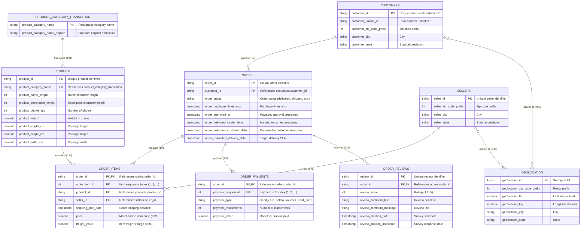

# Entity-Relationship Architecture (ERD)

This document visualizes the relational schema design for the Olist Brazilian E-Commerce dataset.

---

## 1. Mermaid Entity-Relationship Diagram

---

## 2. Relational Modeling Decisions & Highlights

1. **Third Normal Form (3NF) Compliance**:
   - The original CSV schema is normalized into 3NF. Transitive dependencies are isolated (e.g., product category translations are split from the products catalog).
   - Customers have two ID concepts: `customer_id` (a transaction-level key scoped to one purchase) and `customer_unique_id` (representing the human account across repeat purchases).

2. **Composite Primary Keys**:
   - `order_items`: `(order_id, order_item_id)` handles multi-item shopping carts where multiple items of identical or distinct products exist.
   - `order_payments`: `(order_id, payment_sequential)` accommodates split payments (e.g., payment partially via voucher and remainder via credit card).
   - `order_reviews`: `(review_id, order_id)` handles multi-order batches where one review survey covers multiple linked orders.

3. **Geospatial Optimization**:
   - Geolocation data contains multiple coordinate measurements per zip code prefix. To optimize query runtime, `schema/03_views.sql` creates `vw_zip_code_geolocation` which computes centroid coordinates `(AVG(lat), AVG(lng))` per prefix.
